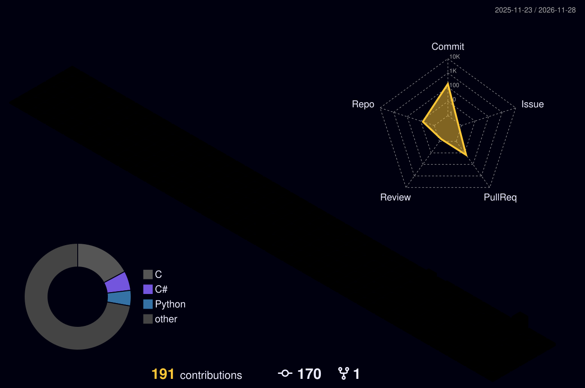

<h1>Hi, I'm Snow Plucking 👋</h1>

<strong>嵌入式开发 · STM32 / ESP8266 · 物联网与传感器系统 · 独立完成从硬件到云端的全链路</strong>

---

## 🧑‍💻 关于我

- 🔭 正在做：STM32F407 智能巡检机器人、STM32 双节点环境监测系统（LoRa + MQTT 上云）
- 🌱 正在学：FreeRTOS、嵌入式 C、通信协议
- 💬 问我：STM32 HAL 开发、I2C/SPI/ADC 驱动、MQTT 上云
- ⚡ 喜欢：吃饭、睡觉、写代码

---

## 🛠️ 技术栈

**嵌入式（主方向）**

**通信与云平台**

**上位机 / 工具**

---

## 📊 语言分布

按主要公开仓库代码量等权估算，统计范围：MyStm32_Esp8266project、BetterESP8266firmware、yimeng-login-fix、deskwidgets-notebook。

---

## 🏔️ 3D 贡献图 & 贡献贪吃蛇

<picture>
  <source media="(prefers-color-scheme: dark)" srcset="https://raw.githubusercontent.com/zhanglove2003/zhanglove2003/output/github-snake-dark.svg">
  <source media="(prefers-color-scheme: light)" srcset="https://raw.githubusercontent.com/zhanglove2003/zhanglove2003/output/github-snake.svg">
  
</picture>

---

## 🚀 我的项目

<table>
<tr>
<td width="50%" valign="top">

<strong>🔧 MyStm32_Esp8266project</strong>

STM32F103 双节点环境监测系统：DHT12 + MQ135 采集 → LoRa 传输 → TFT 显示 → ESP8266 MQTT 上云。连续运行 48h 无死机，上报成功率 ~95%。含 3D 布线模型与逐引脚对照表。

  

<a href="https://github.com/zhanglove2003/MyStm32_Esp8266project">查看仓库 →</a>

</td>
<td width="50%" valign="top">

<strong>🚗 XZCIT-IIR</strong>

智能巡检机器人：STM32F407 四轮底盘，支持麦克纳姆轮与差分配置，OLED 本地界面 + PS2 手柄操控。

 

<a href="https://github.com/zhanglove2003/XZCIT-IIR">查看仓库 →</a>

</td>
</tr>
<tr>
<td colspan="2" valign="top">

<strong>📡 BetterESP8266firmware</strong>

ESP8266 独立固件：WiFi 管理 + ThingsBoard MQTT 遥测/RPC + STM32 串口桥接，PlatformIO 构建并带 GitHub Actions CI。

  

<a href="https://github.com/zhanglove2003/BetterESP8266firmware">查看仓库 →</a>

</td>
</tr>
</table>

---

<strong>欢迎交流，一起搞点有意思的东西！</strong>

